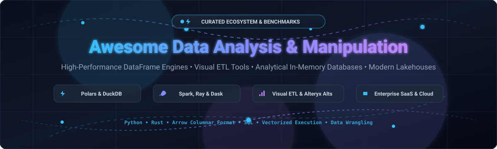

# 📊 Awesome Data Analysis &amp; Manipulation

**A definitive curated index of high-performance DataFrame libraries, in-memory analytical databases, visual ETL wrangling tools, and modern lakehouse platforms.**

*Optimized for Data Science • Analytics Engineering • High-Throughput In-Memory Compute • Visual Data Preparation*

**Last updated: October 2026** ⚡

---

## 📖 Introduction & Ecosystem Scope

This repository provides an exhaustively researched catalog of top **SaaS platforms** and **open-source frameworks** tailored for **Data Analysis, Manipulation, Wrangling, and ETL Pipelines**. Whether managing hundreds of gigabytes on a single developer workstation without cluster overhead (via vectorization and lazy execution) or orchestrating multi-terabyte enterprise lakehouse pipelines, this guide benchmarks the leading commercial solutions and transparent open-source alternatives.

- 🏢 **Enterprise SaaS Leaders**: AWS Glue DataBrew, Tableau Prep, Paxata, Databricks, Alteryx, Dataiku, Talend, Altair RapidMiner, Trifacta, and KNIME.
- ⚡ **High-Speed Open-Source Engines**: Polars, DuckDB, Pandas, Apache Spark, Apache Arrow, marimo, dbt, Dask, OpenRefine, Great Expectations, Datasette, Modin, Mage, Vaex, Ibis, Daft, Rill, Fugue, and Amphi.

Contributions are warmly welcomed! Please read [How to Contribute](#-how-to-contribute) to add or update tools.

## 📑 Table of Contents

- [🌐 Sector Overview & Market Dynamics](#-sector-overview--market-dynamics)
- [🏢 SaaS & Hosted Platforms](#-saas--hosted-platforms)
- [⚡ Open-Source GitHub Projects](#-open-source-github-projects)
  - [🛠️ Frameworks & Ecosystem Utilities](#️-frameworks--ecosystem-utilities)
- [⭐ Star History](#-star-history)
- [💖 Support & Sponsorship](#-support--sponsorship)
- [🤝 How to Contribute](#-how-to-contribute)
- [⚖️ Disclaimer](#️-disclaimer)

## 🌐 Sector Overview & Market Dynamics

The global data preparation and manipulation software market is estimated at **$7.6B to $10.0B** in 2024–2026, compounding at a **15%–16% CAGR** driven by enterprise AI pipeline demands and data pipeline automation. The sector is **moderately fragmented**—dominated at the top by hyper-scalers and mega-cap enterprise analytics suites (AWS, Salesforce/Tableau, Workday, Databricks), yet continually disrupted by agile standalone visual ETL tools, modular lakehouse components, and fast-growing open-source ecosystems.

## 🏢 SaaS & Hosted Platforms

| Product | Company Size (Valuation / Revenue) | Starting Tier Pricing | Free Tier / Free Trial Limits | Description & Core Strengths |
| :--- | :--- | :--- | :--- | :--- |
| **AWS Glue DataBrew** | **~$2.1T+ Market Cap** (Amazon parent; AWS >$105B run-rate) | **$1.00 / interactive session** (30 min) + $0.48 / node-hour for batch jobs | **First 40 interactive sessions free** for first-time users (30-min blocks); Glue Catalog includes 1M free metadata objects/month | Cloud-native visual data preparation service featuring 250+ pre-built transformations, automated profiling, and native S3/Glue lakehouse integration. |
| **Tableau Prep** (Salesforce) | **~$280B Market Cap** (Salesforce parent; Tableau acquired for $15.7B) | **$75 / user/month** ($900/year, Tableau Creator tier) | **14-day free trial** with unrestricted Creator features (Tableau Prep Builder + Desktop + Server/Cloud authoring); no credit card required | Visual pipeline designer for profiling, cleaning, and joining multi-source data; natively publishes extracts directly into Tableau dashboards. |
| **Paxata** (Workday) | **~$70B Market Cap** (Workday parent; acquired Paxata for ~$250M) | Custom enterprise quote (starts at **~$20,000 / year**) | **14-day trial on request** (custom POC/demo environment scoped to specific evaluation datasets; no permanent free plan) | Enterprise self-service data preparation offering automated column profiling, ML-assisted joins, and governance embedded into Workday. |
| **Databricks** | **$43B Valuation** (private; >$2.6B ARR) | **$0.07 / DBU** (Model Serving/Jobs) to $0.40–$0.70 / DBU (Interactive & Serverless SQL) | **14-day free trial with $400 credits** (Serverless SQL capped at 50 DBU/hr); separate Free Edition offers permanent single-cluster serverless notebooks with daily fair usage limits | Unified Lakehouse analytics platform built on Spark, Delta Lake, and MLflow; industry standard for high-throughput enterprise batch and streaming ETL. |
| **Alteryx** | **$4.4B Acquisition Valuation** (acquired by Clearlake & Insight, 2024; ~$950M revenue) | **$250 / user/month** ($3,000/year billed annually, Starter Edition); Designer Desktop at ~$4,950–$5,195/user/year | **30-day free trial** for Alteryx Designer (full access to desktop workflow designer and spatial tools; no permanent free plan) | Benchmark visual workflow platform providing drag-and-drop spatial analytics, data prep, predictive modeling, and extensive ecosystem connectors. |
| **Dataiku** | **$3.7B Valuation** (private; ~$250M+ ARR) | Starts at **~$4,000 / month** (~$48,000–$60,000/year for enterprise cloud deployment) | **Free Edition: Permanent free tier** for up to 3 users (self-hosted local install); or **14-day cloud trial** with 4 vCPUs / 32 GiB memory | Collaborative AI and analytics platform uniting no-code drag-and-drop wrangling, SQL recipes, and Python/R notebooks in a single governed pipeline. |
| **Talend** (Qlik) | **$2.4B Acquisition Valuation** (acquired by Thoma Bravo, now integrated into Qlik) | **$100 / month** (Talend Stitch standard tier, covers up to 5M rows/month) | **14-day free trial** with unlimited row replication and full connector access; includes 7-day grace period for new data source historical syncs | Comprehensive enterprise data integration, transformation, and data quality framework spanning visual ETL, CDC, and automated governance. |
| **Altair RapidMiner** | **$1.8B Valuation** (Altair parent; RapidMiner acquired for ~$100M) | Commercial licenses start at **~$2,500 / user/year** (licensed via Altair Units) | **Free tier: 10,000 data rows max** per dataset in RapidMiner Studio Free; 30-day trial for enterprise AI Studio; free unlimited for verified students/academics | Visual workflow designer covering data extraction, preparation, predictive model training, and automated data science pipelines. |
| **Trifacta** (Alteryx) | **~$400M Acquisition Valuation** (acquired by Alteryx in 2022) | Starts at **$80 / user/month** (Trifacta Starter Cloud edition) | **30-day free trial** of Trifacta Cloud with ML-guided wrangling and warehouse connector evaluation; no permanent free plan | Cloud-native data wrangling platform pioneering machine-learning-assisted transformation recommendations across modern cloud data warehouses. |
| **KNIME** | **~$100M Valuation** (privately funded; ~$30M ARR) | **$99 / month** (KNIME Community Hub Team Plan, includes 3 members; +$49/mo per extra user) | **Free forever desktop version** (KNIME Analytics Platform: unrestricted nodes, local execution, unlimited rows, Python/R integration) | Open-core visual analytics suite with thousands of nodes, database connectors, and seamless scripting bridges for local or collaborative team ETL. |

## ⚡ Open-Source GitHub Projects

Curated open-source repositories for data analysis, transformation, in-memory compute, and visual pipelines—ranked by GitHub star count:

- **[Pandas](https://github.com/pandas-dev/pandas)**   
  **Flexible and powerful data analysis / manipulation library for Python** (BSD-3-Clause) — **the most widely used data manipulation library in the world**. **Key strengths**: **ubiquitous**—every data science tutorial starts with `import pandas as pd`; **rich ecosystem** (scikit-learn, matplotlib, seaborn all accept DataFrames); **full-featured** with merging, joining, grouping, pivoting, and time series. **The critical limitation**: **holds all data in RAM** and is **single-threaded**—a **2.3GB CSV ballooned to 7.2GB in memory** during a benchmark test, causing the OOM killer to terminate the process before completion. **The "Pandas cliff" occurs around tens of gigabytes**—beyond that, it doesn't just slow down, it dies. **Best for**: datasets under 10 million rows, exploration, and any project where the ecosystem's maturity outweighs performance.

- **[Apache Spark](https://github.com/apache/spark)**   
  **Unified analytics engine for large-scale data processing** (Apache-2.0) — **the industry standard for distributed computing**. Provides high-level APIs in Java, Scala, Python (PySpark), and R, alongside an optimized engine supporting general execution graphs, Spark SQL for structured queries, MLlib for machine learning, and structured streaming. **Best for**: multi-terabyte to petabyte datasets distributed across multi-node clusters.

- **[DuckDB](https://github.com/duckdb/duckdb)**   
  **Feature-rich in-process SQL OLAP database** (MIT) — **"SQLite for analytics"**. **Key advantages**: **no external dependencies**, **vectorized SQL queries**, **parallel processing**, **spills to disk automatically when memory pressure rises**, and **queries Parquet/CSV files directly without loading them first**. **Benchmark**: a 2.3GB CSV query completed in **12 milliseconds with 0.4GB peak memory**—**18x less memory than Pandas**. **On the 1 Billion Row Challenge**, DuckDB finished in **5.19 seconds** vs. Pandas' **4 minutes 28 seconds**. **Unlike SQLite (OLTP-optimized), DuckDB is OLAP-optimized**—built for aggregate calculations across large numbers of rows. **Best for**: analytical scans, joins, and aggregations on local files; SQL-heavy workflows; and any "medium data" problem where a cluster is overkill.

- **[Polars](https://github.com/pola-rs/polars)**   
  **Performance-focused, multi-threaded DataFrame library written in Rust** (MIT) — **the modern Pandas replacement for large data**. **Key advantages**: **lazy evaluation** (builds query plans, applies predicate pushdown, eliminates unused columns before execution), **Apache Arrow columnar format**, **multi-threaded by default**, and **streaming execution** for out-of-core processing. **Benchmark**: the same 2.3GB CSV that crashed Pandas completed in **8.7 seconds with 1.8GB peak memory**—**60% less memory and zero crashes**. **On the 1 Billion Row Challenge**, Polars finished in **5.04 seconds** vs. Pandas' **4 minutes 28 seconds**. **Requires strict schema definitions** but rewards with predictable performance. **Best for**: production ETL, datasets that don't fit in RAM, and any Python data workload where performance matters.

- **[marimo](https://github.com/marimo-team/marimo)**   
  **Reactive, reproducible Python notebook designed for data analysis & manipulation** (Apache-2.0). Solves hidden state bugs inherent in legacy Jupyter notebooks by modeling cell relationships as a directed acyclic graph (DAG)—when a variable changes, all downstream dependent cells automatically re-run. Supports interactive dataframes with zero-code filtering/charting, embedded SQL queries on dataframes via DuckDB, and export to standalone web applications or production Python scripts. **Best for**: modern exploratory data analysis, interactive data apps, and reproducible analytical pipelines.

- **[Apache Arrow](https://github.com/apache/arrow)**   
  **Universal columnar in-memory data standard and multi-language toolbox** (Apache-2.0). Provides zero-copy data interchange between disparate processing engines (Polars, DuckDB, Spark, PyTorch, Pandas 2.0). Features PyArrow compute kernels for ultra-fast in-memory record batch filtering, projected scans, and IPC streaming serialization. **Best for**: high-performance data interchange, foundational in-memory analytic pipelines, and eliminating serialization overhead.

- **[dbt (data build tool)](https://github.com/dbt-labs/dbt-core)**   
  **Command-line tool for the transform step of ELT** (Apache-2.0) — **the analytics engineering standard**. Sits on top of data warehouses or lakehouse engines, managing data modeling, testing, version control, and documentation in a structured software engineering workflow. Uses standard modular SQL combined with Jinja templating. **Best for**: warehouse-native data transformation, DAG-based analytics models, and data lineage.

- **[Dask](https://github.com/dask/dask)**   
  **Flexible parallel computing library for Python** (BSD-3-Clause). Dynamically coordinates task graphs across multicore machines and distributed clusters. Provides high-level `dask.dataframe` APIs that mimic Pandas while handling out-of-core streaming and parallel partition execution. Seamlessly integrates with NumPy, Scikit-Learn, and PyTorch. **Best for**: scaling existing Python/Pandas workflows to larger-than-memory datasets or distributed clusters.

- **[OpenRefine](https://github.com/OpenRefine/OpenRefine)**   
  **Free and open-source data cleaning power tool** (BSD-3-Clause) — **the original data wrangling tool**. Runs locally in your browser with complete data privacy. Supports CSV, Excel, XML, and JSON. Features **GREL (General Refine Expression Language)** for algorithmic transformations, faceted browsing, clustering algorithms for fuzzy duplicate resolution, and schema reconciliation against external knowledge bases. **Best for**: cleaning messy tabular data, tabular normalization, and exploratory categorization.

- **[Great Expectations](https://github.com/great-expectations/great_expectations)**   
  **Shared, open standard for data quality and pipeline validation** (Apache-2.0). Allows data analysts and engineers to assert expected schemas, distributions, ranges, and null counts across Pandas, Spark, and SQL databases. Generates human-readable automated documentation (Data Docs). **Best for**: automated unit testing for data pipelines, ETL validation gates, and data quality monitoring.

- **[Datasette](https://github.com/simonw/datasette)**   
  **Open-source multi-tool for exploring, querying, and publishing data** (Apache-2.0). Instantly turns SQLite databases, CSVs, and parquet files into interactive web exploratory dashboards and JSON/CSV APIs. Rich plugin ecosystem enables geospatial mapping, full-text faceted searching, and custom visualizations with zero boilerplate. **Best for**: rapid data exploration, publishing curated datasets, and self-service ad-hoc querying.

- **[Modin](https://github.com/modin-project/modin)**   
  **Scale your Pandas workflows by changing a single line of code** (Apache-2.0). Drop-in Pandas replacement (`import modin.pandas as pd`) powered by Ray or Dask backends. Automatically distributes DataFrame computations across all available CPU cores without requiring manual partition tuning. **Best for**: accelerating existing legacy Pandas codebases without refactoring API calls.

- **[Mage](https://github.com/mage-ai/mage-ai)**   
  **Open-source data pipeline tool for transforming and integrating data** (Apache-2.0). Modern visual and code-based developer experience combining interactive notebooks with production DAG scheduling. Allows writing modular SQL, Python, and R code blocks with instant inline data preview, automated data profiling, and version control. **Best for**: building end-to-end transformation pipelines with an intuitive developer interface.

- **[Vaex](https://github.com/vaexio/vaex)**   
  **Out-of-core DataFrames for Python** (MIT). Capable of visualizing and processing tabular datasets with over a billion rows at 0-memory usage via memory mapping (mmap) on HDF5, Arrow, and Parquet files. Computes aggregations, filtering, and statistical summaries in milliseconds without copying memory. **Best for**: massive single-node exploration, billion-row data visualization, and statistical modeling.

- **[Ibis](https://github.com/ibis-project/ibis)**   
  **Python dataframe interface that compiles to any backend** (Apache-2.0) — **write once, execute anywhere**. Provides a uniform, expressive Pythonic API that compiles directly into high-performance SQL or native queries across 20+ backends including DuckDB, BigQuery, Snowflake, ClickHouse, PostgreSQL, PySpark, and Polars. **Best for**: writing backend-agnostic analytics pipelines that can execute locally or run inside a remote data warehouse.

- **[Daft](https://github.com/Eventual-Inc/Daft)**   
  **Distributed query engine and DataFrame library built in Rust for multimodal data** (Apache-2.0). Unifies tabular data processing with multimodal inputs (images, audio, video, nested documents, embeddings) under an Arrow memory model and lazy query optimizer. Offers Polars-like ergonomics with Ray-powered distributed cluster execution. **Best for**: high-throughput multimodal ETL and feature engineering for AI/ML pipelines.

- **[Rill](https://github.com/rilldata/rill)**   
  **Fast, open-source BI and real-time operational analytics tool powered by DuckDB and ClickHouse** (Apache-2.0). Connects directly to local Parquet/CSV files or cloud object stores, modeling data via code-driven YAML and SQL metrics definitions with sub-second exploratory dashboards. **Best for**: local-first fast metrics exploration, fast BI over data lakes, and dimensional analysis.

- **[Fugue](https://github.com/fugue-project/fugue)**   
  **Unified interface for distributed computing** (Apache-2.0). Lets developers execute native Python, Pandas, and SQL code across Spark, Dask, and Ray without rewriting framework-specific logic. Simplifies distributed execution by abstracting cluster orchestration boilerplate. **Best for**: seamless portability between local prototyping and distributed production execution.

- **[Amphi](https://github.com/amphi-ai/amphi-etl)**   
  **Visual, low-code data preparation and transformation workbench based on Python** (source-available/open-source) — **the open visual ETL tool that generates native Python code**. Bridges the gap between drag-and-drop tools like Alteryx/KNIME and code-first engineering by generating clean, exportable Pandas and DuckDB code. Features LLM integrations for AI-assisted transformations and runs entirely locally. **Best for**: teams seeking visual ETL ease without vendor lock-in or proprietary runtimes.

- **[Loomflow](https://github.com/cardchase/loomflow)**   
  **Self-hosted, lightweight, visual ETL platform inspired by Alteryx** (open-source) — **the open-source Alteryx alternative**. Features Alteryx-inspired configuration panels with tabular grids for managing hundreds of columns, tool containers for grouping/bypassing logic, multi-rule sorting and summarization powered by a native Polars backend, semantic type profiling, agent-ready YAML workflow exports, and an integrated Python IDE. **Best for**: teams looking for a visual Alteryx replacement backed by modern high-speed execution engines.

### 🛠️ Frameworks & Ecosystem Utilities

- **[tidysheet](https://pypi.org/project/tidysheet/)** — Local-first data profiling and reproducible cleaning tool. Profiles messy CSV/Excel/Parquet files, generates human-auditable YAML cleaning pipelines executed via DuckDB, and reverse-engineers cleaning scripts directly from Excel edits.
- **[Hermes](https://pypi.org/project/hermes-plt/)** — Local-first data provenance, lineage, and entity resolution framework designed to work seamlessly on top of Pandas, Polars, PyArrow, and DuckDB.

**Frameworks for building custom systems**: Combine **Polars** or **Apache Spark** for high-performance DataFrame operations with **DuckDB** for SQL-heavy analytics, **Loomflow** or **Amphi** for visual pipeline building, **dbt** for warehouse transformations, **Great Expectations** for validation, and **Hermes** for provenance and lineage—creating a comprehensive data analysis and manipulation stack that handles everything from exploration to production.

## ⭐ Star History

## 💖 Support & Sponsorship

Thank you so much for exploring and using **Awesome-Data-Analysis-Manipulation**! 🌟

If you find this ecosystem guide helpful for your work, research, or data infrastructure, please consider supporting the project:
- ⭐ **Star this repository** to support discovery and visibility!
- 🍴 **Fork and contribute** by submitting new tools, benchmarks, or corrections.
- 📢 **Share with your colleagues**, analytics teams, and communities on LinkedIn, X/Twitter, or Reddit.
- ☕ **Buy me a coffee & sponsor my open-source work**: Support future updates, benchmarks, and curated repositories directly via the **[GitHub Sponsors Dashboard](https://github.com/sponsors/ishandutta2007)**!

Every bit of encouragement and sponsorship keeps this curated knowledge base up to date and community-driven. 🙏

## 🤝 How to Contribute

1. Fork the repo.

2. Add/edit entries in `README.md` (follow existing format).

3. Include: name, link, 1–2 sentence description, and whether it's SaaS or open-source.

4. Submit PR with a short explanation.

Star the repo if you find it useful!

## ⚖️ Disclaimer

- This is a **community-curated** list — not exhaustive and not an endorsement.

- Data analysis tools handling enterprise data must comply with data protection regulations (GDPR, CCPA, etc.) and implement appropriate access controls.

- **The "Big Data" myth drives unnecessary complexity.** Telemetry from Amazon Redshift's fleet shows **94.7% of tables are under 100 GB** and **86.9% of queries scan 80 GB or less** . **Most organizations face "Medium Data" problems**—tens to hundreds of gigabytes—that **single-machine tools like Polars and DuckDB handle easily** without a distributed cluster .

- **Pandas has a hard ceiling.** It **holds all data in RAM** and is **single-threaded**—a 2.3GB CSV balloons to 7.2GB in memory and crashes . **On the 1 Billion Row Challenge**, Pandas took **4 minutes 28 seconds** vs. Polars' **5.04 seconds** and DuckDB's **5.19 seconds** . **Migrate when you hit the cliff**—don't wait for an OOM kill in production.

- **Polars vs. DuckDB: the choice depends on your interface preference.** **Polars** for a **Pythonic DataFrame API** that feels like a faster Pandas . **DuckDB** for **SQL-native workflows** and querying files directly without loading them first . **Both spill to disk automatically and parallelize across cores**—the difference is ergonomic, not architectural .

- **Visual ETL is no longer a commercial-only category.** **Loomflow** provides **Alteryx-inspired configuration panels** with a **Polars backend** and **agent-ready YAML export** . **Amphi** generates **native pandas and DuckDB code you can export and run anywhere** . **The visual builder no longer means vendor lock-in.**

- **Self-hosted open-source solutions require proper memory management, schema validation, and pipeline testing.** **Use engines that spill automatically**—hand-rolling chunked joins in Pandas is **5-50x slower and far more fragile** than declarative SQL or Polars expressions . **Reach for hand-rolling only when no engine fits the workload** .

---

**Made for data analysts, analytics engineers, and organizations building transparent data manipulation solutions.**  

Let's make Data Analysis & Manipulation more open, data-driven, and performant.
